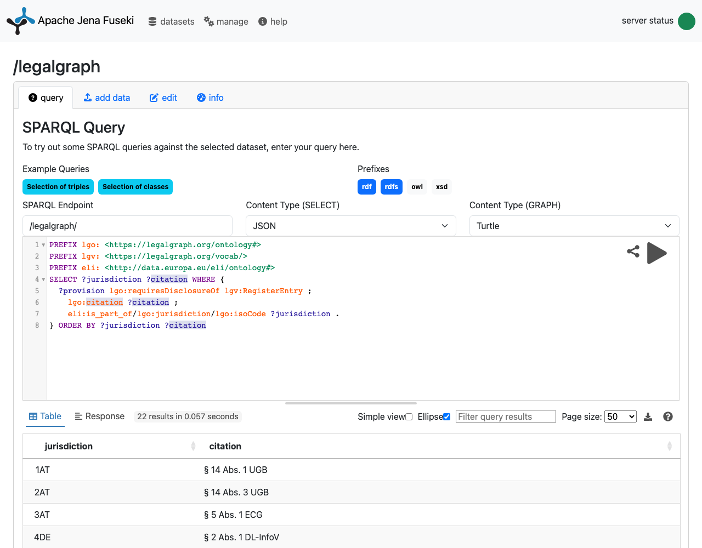

# Query the graph with SPARQL in your browser

The graph is plain RDF, so any SPARQL server can load it. This repository comes with an optional
setup for [Apache Jena Fuseki](https://jena.apache.org/documentation/fuseki2/): one command, and you
get a query editor in the browser and a SPARQL endpoint for your own scripts.

You need [Docker](https://docs.docker.com/get-docker/) and, to build the export,
[uv](https://docs.astral.sh/uv/).

## Start it

```sh
make sparql
```

This writes `dist/legalgraph-with-ontology.ttl` (the data, the ontology and the vocabularies in one
file) and starts Fuseki with `docker compose up`. Open <http://localhost:3030>, choose the
**legalgraph** dataset, and you are on its query page. (`ds` is the image's own empty dataset; you
can ignore it.)



Stop it with `Ctrl+C`, or `docker compose down` if it runs in the background (`docker compose up -d`).
On another port: `FUSEKI_PORT=3031 docker compose up`.

## Your first query

Paste this into the editor and press the run button. It asks which provisions, in which
jurisdictions, require a business to name its register entry (the German *Handelsregister* number,
for example):

```sparql
PREFIX lgo: <https://legalgraph.org/ontology#>
PREFIX lgv: <https://legalgraph.org/vocab/>
PREFIX eli: <http://data.europa.eu/eli/ontology#>

SELECT ?jurisdiction ?citation
WHERE {
    ?provision lgo:requiresDisclosureOf lgv:RegisterEntry ;
        lgo:citation ?citation ;
        eli:is_part_of/lgo:jurisdiction/lgo:isoCode ?jurisdiction .
}
ORDER BY ?jurisdiction ?citation
```

More queries are in [queries/](../queries); each file starts with a comment saying what it asks. The
classes and properties you can query are described in [ontology/README.md](../ontology/README.md),
and every identifier has a page on [legalgraph.org](https://legalgraph.org) (for example
`https://legalgraph.org/id/DE-DDG-s5-1`).

## From a script

The endpoint is `http://localhost:3030/legalgraph/sparql`:

```sh
curl -s http://localhost:3030/legalgraph/sparql \
  --data-urlencode query@queries/register-entry.rq \
  -H 'Accept: text/csv'
```

Results come as CSV, TSV, SPARQL JSON or XML, depending on the `Accept` header.

## What this setup is, and is not

- **Read-only and in memory.** The dataset is loaded from the export on every start; nothing you do
  in the browser changes the repository. After changing the data, run `make sparql` again.
- **For your own machine.** The port is bound to `127.0.0.1` and the web interface has no login
  ([docker/fuseki-shiro.ini](../docker/fuseki-shiro.ini)). Do not expose it on a network as it is.
- **Not needed to work on the graph.** `make check` validates the graph with Python alone, and
  `uv run legalgraph query` runs the queries in `queries/` without a server.

The image is [secoresearch/fuseki](https://hub.docker.com/r/secoresearch/fuseki), a maintained build
of Apache Jena Fuseki; the version is pinned in [docker-compose.yml](../docker-compose.yml).
